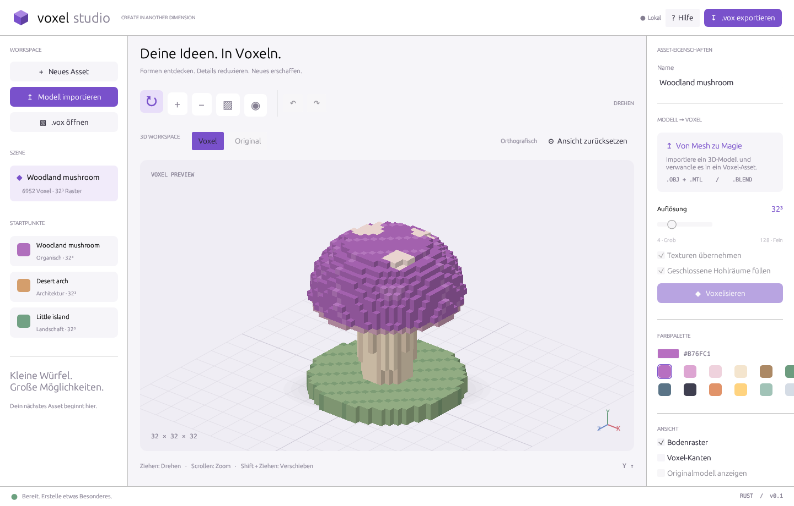

# Voxel Studio

Ein nativer 3D-Voxel-Editor in Rust mit heller, violetter Oberfläche. Modelle importieren, Auflösung einstellen, Voxel bearbeiten und als MagicaVoxel-`.vox` speichern.



## Start

Voraussetzungen: **Rust ab 1.89**, ein Desktop mit OpenGL und für `.blend`-Importe **Blender ab 3.6**. Blender muss als `blender` im PATH liegen. Alternativ `BLENDER_PATH` auf die ausführbare Blender-Datei setzen.

```sh
cargo run --release
```

In diesem Arbeitsbereich ist außerdem `./run.sh` verfügbar; es findet auch die lokal installierte Rust-Toolchain. Der erste Release-Build kann einige Minuten dauern.

Linux benötigt die üblichen Desktop-Bibliotheken (X11/Wayland, EGL/OpenGL, xkbcommon) und für native Dateidialoge einen laufenden Desktop-Portal-Dienst (`xdg-desktop-portal` mit passendem GNOME-, KDE- oder GTK-Backend). Auf Debian/Ubuntu sind für den Build insbesondere `build-essential` und `pkg-config` erforderlich. Windows/macOS werden von den verwendeten Rust-Bibliotheken unterstützt, wurden hier aber nicht geprüft.

Datei direkt öffnen, auch ohne Dateidialog:

```sh
cargo run --release -- --open assets/textured-cube.obj
cargo run --release -- --open assets/textured-cube.blend
cargo run --release -- --open assets/textured-cube.vox
```

## Arbeiten mit dem Editor

1. **Modell importieren**: `.obj` oder `.blend` auswählen. Die rechte Seitenleiste zeigt eine Vorschau, die Dreieckanzahl und vorhandene Bildtexturen.
2. **Auflösung einstellen**: 4–128 Voxel pro Dimension des umschließenden Würfelrasters. Die längste Modellachse bestimmt den Maßstab; die Proportionen bleiben erhalten. Nach 450 ms ohne Änderung beginnt die Voxelisierung automatisch. Der Button „Voxelisieren“ startet sie sofort.
3. **Importoptionen**: UV-Texturen übernehmen oder diffuse Materialfarben verwenden. Geschlossene Hohlräume lassen sich füllen; offene Geometrie wird als Oberfläche übernommen.
4. **Bearbeiten**: Voxel an sichtbaren Flächen hinzufügen, entfernen, färben oder eine Farbe mit der Pipette aufnehmen. Das ausgewählte Voxel wird hervorgehoben. Alle Bearbeitungen sind rückgängig machbar.
5. **Exportieren**: `.vox exportieren` speichert das Modell. `.vox öffnen` lädt einzelne MagicaVoxel-Modelle zur weiteren Bearbeitung.

Neue Assets beginnen mit einem Voxel im 32³-Raster. Drei bearbeitbare Beispielassets sind eingebaut. Wird das letzte Voxel entfernt, fügt ein Klick mit dem Hinzufügen-Werkzeug wieder ein Startvoxel ein.

| Eingabe | Aktion |
| --- | --- |
| 1 / 2 / 3 / 4 / 5 | Drehen / Hinzufügen / Entfernen / Färben / Pipette |
| Links ziehen im Drehen-Werkzeug | Kamera drehen |
| Rechts ziehen mit jedem Werkzeug | Kamera drehen |
| Shift + Ziehen | Kamera verschieben |
| Mausrad | Zoom |
| Strg+Z / Strg+Shift+Z | Rückgängig / Wiederholen |
| Strg+S | Als `.vox` exportieren |
| Strg+O | Modell importieren |

Auf macOS entsprechen die Strg-Kombinationen der Command-Taste. Erneute Voxelisierung ersetzt manuelle Änderungen; Rückgängig stellt die vorherige Version wieder her. Der Verlauf speichert bis zu 30 Zustände und begrenzt bei großen Modellen die gespeicherte Voxelanzahl. Beim Projektwechsel und Schließen erscheint bei ungespeicherten Änderungen ein Dialog zum Exportieren, Verwerfen oder Abbrechen.

## Texturen und Blender

- OBJ: `.mtl`-Dateien und darin referenzierte Bildtexturen mitliefern. Texturpfade werden relativ zur jeweiligen MTL-Datei aufgelöst, auch in Unterordnern. Fehlende Texturen werden mit Pfad und Fehlermeldung angezeigt; Geometrie und diffuse Farben bleiben nutzbar.
- Bildformate: PNG, JPEG, TGA und BMP. UV-Koordinaten werden wiederholt, mit zum OBJ-Format passender vertikaler Bildorientierung.
- BLEND: Blender läuft im Hintergrund und exportiert die render-sichtbaren Mesh-, Kurven-, Text- und Oberflächenobjekte der aktiven Szene inklusive ausgewerteter Modifikatoren über OBJ. Gepackte Bildtexturen werden in ein temporäres Verzeichnis extrahiert. Blender-Dateiskripte werden durch `--disable-autoexec` nicht automatisch ausgeführt. Die Quelldatei wird nicht gespeichert oder verändert.
- Übernommen werden diffuse Farben und Bildtexturen. Prozedurale Shader, komplexe Node-Netze und UDIMs bitte vorab auf eine einzelne diffuse Bildtextur backen. Transparenz, Normalmaps, Beleuchtung und PBR-Materialparameter sind nicht Bestandteil des Voxelmodells. Instanzen sollten zuvor in echte Mesh-Objekte umgewandelt werden.
- Die Originalvorschau approximiert Bildtexturen durch unterteilte Dreiecke. Die Voxelisierung selbst berechnet pro getroffenem Voxel einen UV-Samplepunkt.

## Dateiformat und Grenzen

Der Export schreibt MagicaVoxel VOX v150 mit `MAIN`, `SIZE`, `XYZI` und `RGBA`. Editor-Y wird beim Export auf MagicaVoxel-Z gedreht und beim Import zurückgedreht. Bis zu **255 unterschiedliche Farben** bleiben exakt erhalten. Bei mehr Farben wird auf eine gleichmäßige Palette mit **216 RGB-Farben** reduziert; jede Farbkomponente weicht dann höchstens 25 Stufen ab. Exportdateien werden zunächst vollständig in eine temporäre Datei geschrieben und anschließend an den Zielpfad verschoben.

VOX-Import unterstützt ein einzelnes Modell bis 256³ mit expliziter oder Standardpalette. Mehrteilige VOX-Szenen mit Szenengraph/Transformationen sind kein unterstütztes Bearbeitungsformat. Die Auflösung von Mesh-Importen ist auf 128³ begrenzt. Große oder stark triangulierte Modelle können länger rechnen und mehr Speicher beanspruchen. Dateiladen und Voxelisierung laufen in Hintergrundthreads; der Renderer sortiert sichtbare Oberflächen orthografisch und verwendet egui/OpenGL.

## Konvertierung ohne Oberfläche

```sh
cargo run --release -- --convert assets/textured-cube.obj output.vox 64
cargo run --release -- --convert assets/textured-cube.blend output.vox 32
```

Die optionale Auflösung liegt zwischen 4 und 128 (Standard: 32). Der CLI-Konverter übernimmt Texturen und füllt geschlossene Hohlräume. Er benötigt kein Display; Blender benötigt für den Hintergrundimport ebenfalls kein Display.

## Prüfung

```sh
cargo test
cargo test -- --include-ignored   # zusätzlich echter Blender-Import
cargo clippy --all-targets -- -D warnings
cargo fmt --check
```

Getestet werden Dreieck/Voxel-Schnittpunkte, baryzentrische Texturkoordinaten, Hohlraumfüllung, texturierte OBJ-Dateien, verschachtelte Materialpfade, fehlende Texturen, gepackte Blender-Texturen, VOX-Farb-/Achsen-Roundtrips, Farbquantisierung und beschädigte Dateien. Ein Checker-Würfel liegt als OBJ, BLEND und VOX unter `assets/` bei.

Geprüft unter Debian 13 mit Blender 4.3.2: alle zehn Tests einschließlich Blender-Import erfolgreich, Clippy ohne Warnungen. Die native Oberfläche wurde auf einem virtuellen X11-Display geprüft. Ein zusätzlicher Eingabetest hat Hinzufügen, Rückgängig und Wiederholen ausgeführt; die zurückgestellten 3D-Ansichten waren jeweils pixelgenau identisch.

Für einen reproduzierbaren UI-Screenshot unter einem vorhandenen Desktop:

```sh
VOXEL_SCREENSHOT=assets/screenshot.png cargo run
```

Diese Testoption beendet die Anwendung nach der Aufnahme. Die mitgelieferte Dummy-Xorg-Konfiguration unter `scripts/` dient ausschließlich visuellen Tests in Linux-Umgebungen ohne Desktop.

## Aufbau

- `src/main.rs`: Oberfläche, Werkzeuge, Verlauf, Hintergrundjobs und CLI.
- `src/model.rs`: OBJ-/Blender-Import, Materialien, UV-Sampling, SAT-Voxelisierung und Flood-Fill.
- `src/render.rs`: orthografische 3D-Ansicht, sichtbare Voxel-Flächen und Flächenauswahl.
- `src/vox.rs`: MagicaVoxel-Import/-Export und Farbpalette.
- `scripts/blend_export.py`: Blender-Bridge.

Die eingebettete DejaVu-Schrift ergänzt Symbole; ihre Lizenz liegt unter `assets/fonts/LICENSE-DejaVu.txt`.
